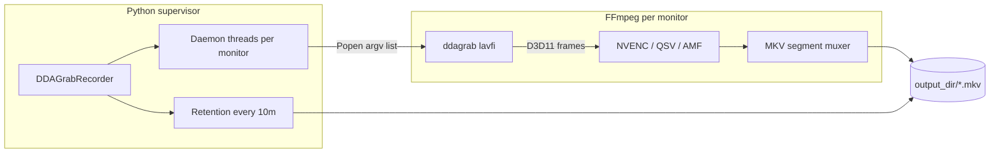

# Add DDAGrab 24/7 desktop recorder backend

## Architecture fit (from codebase)

No shared recorder ABC exists. Two capture styles today:

- Frame-pipe: [`VideoRecorder`](continuous_video_recorder/src/recorder.py) (VidGear WriteGear; Python sees frames)
- FFmpeg subprocess: [`DirectShowAVRecorder`](continuous_video_recorder/src/dshow_recorder.py) (best process template: `Popen` + stderr drain + `q`-to-stdin stop)

There is **no** desktop/`ddagrab` code yet. `capture.backend` is currently only `frame_pipe` | `dshow_av` in [`ConfigLoader`](continuous_video_recorder/src/config_loader.py).

**Decision:** Add a **separate** backend. Do not wire into `main.py` presence detection or frame_pipe (that would pull frames through Python/CPU). Mirror process hygiene from `DirectShowAVRecorder`, but use the prompt’s lifecycle: built-in supervisor, FFmpeg `-f segment`, hardware encode only, multi-monitor = one process each.



## Files to add / change

| Action | Path |
|--------|------|
| Add | [`src/ddagrab_recorder.py`](continuous_video_recorder/src/ddagrab_recorder.py) — core: config dataclass-from-dict, encoder probe, command builder, supervisor, retention, public API |
| Add | [`config_ddagrab_desktop.yaml`](continuous_video_recorder/config_ddagrab_desktop.yaml) — example YAML |
| Add | [`examples/ddagrab_example.py`](continuous_video_recorder/examples/ddagrab_example.py) — thin runner (like debut) |
| Add | [`tests/test_ddagrab_recorder.py`](continuous_video_recorder/tests/test_ddagrab_recorder.py) |
| Edit | [`src/config_loader.py`](continuous_video_recorder/src/config_loader.py) — defaults + allow `ddagrab` backend + validate new fields |
| Edit | [`pyproject.toml`](continuous_video_recorder/pyproject.toml) — console script `ddagrab-desktop` |
| Edit | [`README.md`](continuous_video_recorder/README.md) — short “Desktop DDAGrab backend” section |

No new pip dependencies (stdlib only + external `ffmpeg` on PATH).

## Config shape

Extend `DEFAULT_CONFIG` with `capture.backend` allowing `"ddagrab"` and a nested `ddagrab` section (keeps webcam/dshow keys out of this path):

```yaml
capture:
  backend: ddagrab
ddagrab:
  ffmpeg_path: null          # null → shutil.which("ffmpeg")
  output_dir: ./desktop_recordings
  framerate: 4
  dup_frames: false
  output_idx: [0]            # list → one process per monitor
  draw_mouse: true
  video_size: null           # optional "WxH"
  offset_x: null
  offset_y: null
  encoder: auto
  cq: 32
  gop: 1200
  segment_seconds: 3600
  filename_pattern: "%Y-%m-%d_%H-%M-%S_mon{idx}.mkv"
  restart_backoff_initial: 2
  restart_backoff_max: 60
  restart_stable_reset_s: 300
  retention_max_gb: null
  retention_max_days: null
  process_priority: below_normal   # below_normal | idle | normal
```

Validation in `_validate_config`: Windows-only when backend is `ddagrab` (or raise at recorder construct time like dshow); encoder enum; framerate > 0; cq/gop/segment positive; priority allowlist.

## Core implementation (`DDAGrabRecorder`)

Public API (prompt style; this is a 24/7 supervisor, not a session splitter like dshow):

- `start()`, `stop()`, `is_running`, `status() -> dict`
- Context manager (`__enter__`/`__exit__`)
- Idempotent `stop()`; register `atexit` on `start()`; example also uses existing `setup_signal_handlers` from [`src/utils.py`](continuous_video_recorder/src/utils.py)

Internals:

1. **Platform / FFmpeg guards:** `sys.platform == "win32"` else `NotImplementedError`. Parse `ffmpeg -version` → require ≥ 6.0. Resolve `ffmpeg_path`.

2. **Encoder detection (once, cached):** Parse `ffmpeg -hide_banner -encoders`. Preference: `av1_nvenc` → `hevc_nvenc` → `av1_qsv` → `hevc_qsv` → `av1_amf` → `hevc_amf` → `h264_nvenc` → `h264_qsv` → `h264_amf`. Probe each with ~1s encode: `ffmpeg -f lavfi -i ddagrab=framerate=4 -frames:v 4 -c:v <enc> -f null -`. Never fall back to software. Map `cq` → NVENC `-cq`, QSV `-global_quality`, AMF `-qp_i`/`-qp_p`.

3. **Command builder** (argv list only; no `shell=True`; no `-nostdin` because stdin is PIPE for graceful `q`):

```
ffmpeg -hide_banner -loglevel warning
  -f lavfi -i ddagrab=output_idx=N:framerate=4:dup_frames=0:draw_mouse=1
  -c:v <hwenc> ... -g 1200 -bf 0
  -fps_mode vfr
  -f segment -segment_time 3600 -reset_timestamps 1 -strftime 1
  -segment_format matroska
  <output_dir>/<pattern with mon{idx}>
```

Hard asserts in builder/tests: no `hwdownload`, no `libx264`/`libx265`, MKV only, `dup_frames=0` when configured false, `-fps_mode vfr` present.

4. **Process launch:** `CREATE_NO_WINDOW | BELOW_NORMAL_PRIORITY_CLASS` (or idle/normal per config). Stderr drain thread → logger (rate-limited) + last ~50 lines. Priority via `creationflags`.

5. **Supervisor thread per monitor:** Block on `proc.wait()`. On exit (expected for DPI/UAC/lock/sleep/hotplug), restart with exponential backoff (2→60 s), reset after 5 min stable. Graceful stop: `q` → wait 5 s → `terminate` → `kill` (same pattern as [`_stop_process`](continuous_video_recorder/src/dshow_recorder.py:221-263), slightly shorter quit timeout).

6. **Stall logging:** Do **not** restart on idle desktop (`dup_frames=0`). Log if process dead unexpectedly or stderr indicates capture failure; file-growth alone is not a restart trigger.

7. **Retention:** Background timer ~every 10 minutes; delete oldest `*.mkv` under `output_dir` until under `retention_max_gb` and/or age &lt; `retention_max_days`.

8. **`status()`:** encoder, per-monitor PID, uptime, restart count, current segment path(s), bytes written today (sum sizes of today’s matching files).

## Example + CLI

[`examples/ddagrab_example.py`](continuous_video_recorder/examples/ddagrab_example.py): load `config_ddagrab_desktop.yaml`, construct recorder, `start()`, block until signal, `stop()`. Log chosen encoder and full argv once.

`pyproject.toml`:

```toml
ddagrab-desktop = "examples.ddagrab_example:main"
```

Optional argparse overrides: `--monitors`, `--cq`, `--out` (thin; YAML remains primary).

## Tests ([`tests/test_ddagrab_recorder.py`](continuous_video_recorder/tests/test_ddagrab_recorder.py))

Mirror [`tests/test_dshow_recorder.py`](continuous_video_recorder/tests/test_dshow_recorder.py) style:

- Command builder: flags per encoder family; `dup_frames=0`; `-fps_mode vfr`; segment/MKV; **forbid** `hwdownload` / software codecs.
- Backoff + retention: temp dir with fake mtimes/sizes.
- Supervisor: mock `Popen` that exits immediately → assert restart + backoff (patch `time.sleep` / wait).
- Platform: constructing off Windows raises.
- Integration (mark `@pytest.mark.integration`, skip unless `win32` and `ffmpeg` available): record ~10 s, graceful stop, `ffprobe` ≥1 video stream.

## Docs (README)

Short section covering: why (GPU-only, idle ≈ 0 cost); config defaults (`cq` 30–35; AV1 on RTX40+/Arc/RDNA3+); must run in interactive user session (Task Scheduler “At log on”, not Session 0 service); extract clip/frame via `ffmpeg -ss …`; measure disk after 24 h and tune `cq`/`gop`.

## Explicit non-goals

- No LSL / timing sidecars for this backend (dshow/debut stays the sync path).
- No audio mux (keeps D3D11→encoder path pure).
- No changes to `VideoRecorder` / `main.py` presence loop.
- No software-encoder fallback under any condition.

## Assumptions

- Class name `DDAGrabRecorder` (matches prompt; dshow uses `DirectShowAVRecorder`).
- Nested YAML key `ddagrab:` rather than flattening into `capture.*`.
- Multi-monitor via `output_idx` list; single int also accepted and normalized to a one-element list.
- “Bytes written today” = sum of matching segment files whose mtime (or name date) is today in local time.
- After implement: report changed files, the machine’s probed encoder + final argv, and these assumptions.
