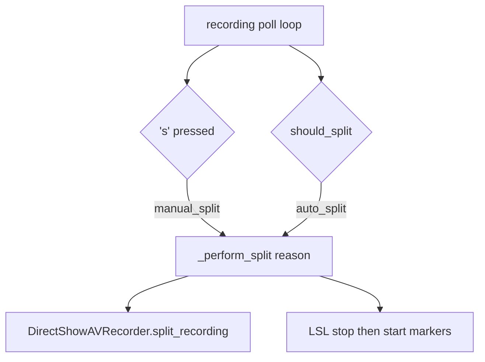

# Allow `'s'` to split Debut recordings

Wire a manual split into [`examples/debut_example.py`](examples/debut_example.py) only. Leave [`main.py`](main.py) Ctrl+S and the USB `'p'` preview toggle unchanged.

Debut is Windows DirectShow (`capture.backend=dshow_av`), so keyboard input can use `msvcrt` in the existing poll loop (same pattern as [`UsbPreviewWindow.process_terminal_input`](src/usb_continuous_recorder.py)).

## Split helper

Extract the current auto-split block (~lines 274–301) into `_perform_split(reason: str) -> bool`:

- Print/log why the split happened (`auto_split` vs `manual_split`)
- Call `recorder.split_recording()`
- Send LSL stop on the old file and start on the new file (`reason` in stop metadata already goes through [`_send_stop_marker`](examples/debut_example.py))
- On success, reset stall/heartbeat size tracking (`last_size`, `last_size_change`, `seen_growth`, `last_heartbeat`)
- Return `False` if old/new file is missing so the loop can still `_fail_recording(...)`

Auto-split keeps calling this with `"auto_split"`.

## `'s'` key in the poll loop

Each iteration (before `time.sleep(0.5)`), drain console keys when `msvcrt` is available:

- Ignore if `hotkeys.manual_split_enabled` is false (default is already true in [`ConfigLoader.DEFAULT_CONFIG`](src/config_loader.py))
- Skip Windows extended-key prefixes (`\x00` / `\xe0`) by consuming the following scan code
- On `'s'` / `'S'`, call `_perform_split("manual_split")` and fail the run if the split fails
- Do nothing if not currently recording

Startup copy: change `Recording in progress... Press Ctrl+C to stop` to also mention **press `s` to start a new file**. Add the same note to the module docstring.

## Out of scope

- [`src/terminal_hotkey.py`](src/terminal_hotkey.py) / [`main.py`](main.py) Ctrl+S
- USB continuous recorder
- Config YAML changes (defaults already enable manual split)
