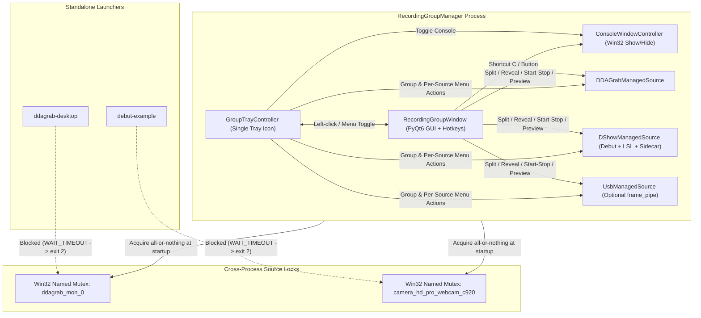

# Recording Groups with Status Window, Single-Tray Management, and Per-Source Singletons

## Architecture Overview

A single `RecordingGroupManager` process loads two or more source configurations (for example `ddagrab` desktop capture and `debut` DirectShow webcam A/V), acquires OS-level exclusive locks for every monitored hardware source before starting capture (fail-fast all-or-nothing), supervises each source on isolated worker threads, and presents both a **displayable PyQt6 Group Status Window** on the main thread and **one Windows system tray icon**.

Standalone launchers (`debut-example`, `ddagrab-desktop`, `epocx-eyecam-usb`, and `main.py`) acquire the exact same per-source OS locks on startup, preventing any standalone script or overlapping group from launching while its source is already monitored.

## 1. Cross-Process Per-Source Singleton Locking

Create [src/source_singleton.py](continuous_video_recorder/src/source_singleton.py) to provide deterministic hardware-source lock keys and crash-safe OS mutexes:

- **Canonical source key derivation (`derive_source_lock_keys(config)`)**:
  - `capture.backend == "ddagrab"`: emits one key per monitor index in `ddagrab.output_idx`, e.g. `ddagrab:monitor_0`, `ddagrab:monitor_1`.
  - `capture.backend == "dshow_av"`: resolves video device via `resolve_dshow_devices_from_config` in [src/dshow_devices.py](continuous_video_recorder/src/dshow_devices.py) (falling back to `webcam.camera_0.name`) and normalizes to `camera:<normalized_name>` (e.g. `camera:hd_pro_webcam_c920`).
  - `capture.backend == "frame_pipe"`: emits `camera:<normalized_name>` for each configured camera with a `name`, or `camera_index:<device_index>` when unnamed.
- **OS-level lock primitive (`SourceSingletonGuard`)**:
  - **In-process guard**: tracks held keys in a process-global locked `set[str]` so duplicate sources inside the same group YAML are also caught immediately (Win32 mutexes are recursive on the same thread).
  - **Windows (`win32`)**: creates `Local\ContinuousVideoRecorder_Source_v1_<slug>` via `ctypes.windll.kernel32.CreateMutexW(None, False, name)` and acquires ownership non-blockingly via `WaitForSingleObject(handle, 0)` (`WAIT_OBJECT_0` or `WAIT_ABANDONED` succeeds; `WAIT_TIMEOUT` fails immediately). If the owning process crashes or is killed, Windows automatically releases/abandons the kernel object with zero stale lock cleanup needed.
  - **Non-Windows fallback**: non-blocking `fcntl.flock(..., LOCK_EX | LOCK_NB)` lock file under `~/.cache/continuous_video_recorder/locks/`.
  - **Diagnostic owner metadata**: writes informational JSON (`pid`, `program`, `source_key`, `config_path`, `started_at`) to `%LOCALAPPDATA%\continuous_video_recorder\locks\<slug>.json` upon acquisition so blocked instances print which PID and group/script owns the source.
  - **All-or-nothing batch acquisition**: `acquire_sources_all_or_nothing(keys, owner_info)` acquires keys in sorted order (preventing lock-order deadlocks); if any key is already held, it immediately releases all keys acquired earlier in the call and raises `SourceAlreadyLockedError`.
- **Wire into all existing standalone entry points**:
  - [examples/debut_example.py](continuous_video_recorder/examples/debut_example.py): acquire lock before constructing `DirectShowAVRecorder`; exit with code `2` and clear message on `SourceAlreadyLockedError`.
  - [examples/ddagrab_example.py](continuous_video_recorder/examples/ddagrab_example.py): acquire lock after applying `--monitors` CLI overrides and before `recorder.start()`.
  - [examples/epocXEyeCamUSB_example.py](continuous_video_recorder/examples/epocXEyeCamUSB_example.py): acquire lock before `recorder.initialize()`.
  - [main.py](continuous_video_recorder/main.py): acquire lock in `ContinuousVideoRecorder.run()` and release in `shutdown()`.

## 2. Reusable Managed Source Runners & DDAGrab Segment Split

### Enhance `DDAGrabRecorder` for Tray Parity
In [src/ddagrab_recorder.py](continuous_video_recorder/src/ddagrab_recorder.py):
- Add `split_recording() -> Dict[int, Optional[Path]]`:
  - Marks each `_MonitorWorker` with a transient `_manual_split_pending` flag so `_supervise_monitor` resets backoff delay to `0` and does not count the intentional stop as a failure restart.
  - Guards against 1-second `-strftime` filename collisions (waits until the wall-clock second advances if the active segment started in the current second), then calls `_graceful_stop_worker` in parallel so FFmpeg finalizes the current `.mkv` and immediately opens a new segment.
- Expose `get_current_file() -> Optional[Path]` (first monitor's newest active segment via `_find_current_segment`) and `output_dir -> Path` for Explorer reveal.

### Create Managed Source Abstractions
Create [src/recording_group.py](continuous_video_recorder/src/recording_group.py) with a common `ManagedRecordingSource` interface (`source_id`, `label`, `backend`, `start()`, `stop()`, `split()`, `open_folder()`, `toggle_preview()`, `supports_preview()`, `is_recording()`, `get_current_file()`, `get_output_dir()`, `status_snapshot()`, `get_log_tail()`, `state_summary()`, `has_error()`):

- **`DDAGrabManagedSource`**: wraps `DDAGrabRecorder`, exposing active monitor segment path(s), hardware encoder, segment duration, bytes written today, restart count, and FFmpeg stderr tail.
- **`DShowManagedSource`**: encapsulates the DirectShow A/V session lifecycle currently written with globals in [examples/debut_example.py](continuous_video_recorder/examples/debut_example.py) (`DirectShowAVRecorder` + `LSLTrigger` + timing sidecars + auto-split + 90s file-growth stall detection + `poll_process()`), running its 0.5s supervisor poll loop on a dedicated daemon thread:
  - Unlike standalone `debut_example.py` which calls `sys.exit(1)` on FFmpeg exit/stall, `DShowManagedSource` isolates failures to itself: finalizes the segment + sends LSL `"error"` stop marker, transitions its source state to error/reconnecting with exponential backoff (configurable `restart_on_error: true`), and never terminates sibling sources like `ddagrab`.
  - Captures recent source log + FFmpeg stderr lines in a thread-safe ring buffer (`get_log_tail()`) for display in the status window.
- **`UsbManagedSource`**: wraps `UsbContinuousRecorder` from [src/usb_continuous_recorder.py](continuous_video_recorder/src/usb_continuous_recorder.py) (with internal `tray.enabled = False` so it delegates to the group tray) on a dedicated worker thread, supporting live `toggle_preview()` (`'p'` parity) so `epocX` configs can also participate in groups.
- **`RecordingGroupManager`**:
  - Loads group YAML or CLI `--sources` list, merges per-source `overrides`, derives union of source lock keys, acquires `SourceSingletonGuard` (all-or-nothing), starts enabled sources, coordinates the PyQt6 `RecordingGroupWindow` (when GUI is enabled) + single `GroupTrayController` + console hotkeys (`s` / `Ctrl+S` = split all, `o` = open folders, `p` = toggle preview, `w` = show/hide status window, `Ctrl+C` = shutdown), and stops all sources in parallel on exit while keeping singleton locks held until shutdown completes.

## 3. Displayable PyQt6 Group Status & Control Window

Create [src/group_window.py](continuous_video_recorder/src/group_window.py) using existing `PyQt6` (`pyqt6>=6.10.2` in [pyproject.toml](continuous_video_recorder/pyproject.toml)) to provide an interactive dashboard (`RecordingGroupWindow`) running on the main thread (`QApplication.setQuitOnLastWindowClosed(False)`):

- **Window lifecycle & tray integration**:
  - Shown on startup by default (`group.show_window_on_start: true`); optionally hides the raw Win32 console on startup (`group.hide_console_on_start: false` default, configurable) while keeping it toggleable at any time.
  - Closing (`X`) or minimizing the window hides it to the system tray without interrupting any recording.
  - Left-clicking the tray icon (or choosing `Show/Hide Status Window` in the tray menu, or pressing `w` in the console) toggles/raises the window.
  - Periodic `QTimer` (500 ms) refreshes live source state, paths, durations, file sizes, console visibility button text, and drains tray/console events cleanly alongside Python `SIGINT` handling.
- **Top group header & global action bar**:
  - Group name + aggregate state pill (`2/2 Recording`, `Partial`, `Error`, `Stopped`).
  - Toolbar buttons with visible shortcut hints:
    - `Split All (S)` — splits all active sources immediately.
    - `Reveal All in Explorer (O)` — reveals active files/folders for all sources.
    - `Show Console (C)` / `Hide Console (C)` — toggles the attached Win32 console window via `_ConsoleWindowController`.
    - `Toggle Logs (L)` — expands/collapses per-source live log/stderr output panes across cards.
    - `Hide to Tray (Esc)` — hides the window to the system tray.
    - `Stop All & Exit (Ctrl+Q)` — graceful shutdown of all sources and application exit.
- **Per-source status cards (`SourceStatusCard`, indexed `1..N`)**:
  - **Status header**: live indicator dot + badge (`RECORDING`, `STOPPED`, `STARTING`, `ERROR / RETRYING`), source label, backend tag (`ddagrab` / `dshow_av` / `usb_continuous`), encoder/device summary, active segment duration, current file size / bytes today, and restart count.
  - **Current recording path row**: read-only selectable monospace field displaying the full path of the active recording file (or output folder when stopped), paired with **Copy Path** and **Reveal in Explorer** (`reveal_in_file_manager` from [src/utils.py](continuous_video_recorder/src/utils.py), using `explorer /select,"<file>"`).
  - **Per-source controls**:
    - `Split` — split just this source's current segment.
    - `Reveal in Explorer` — open Explorer with this source's active recording selected.
    - `Stop Source` / `Start Source` — stop or restart this source independently while keeping its singleton lock held.
    - `Toggle Preview (P)` — enabled for preview-capable camera sources (`usb_continuous` / `frame_pipe`).
    - `Console / Logs` toggle — expands/collapses a live monospace log + FFmpeg stderr tail drawer specific to that source so individual source output can be inspected without opening the raw OS console.
- **Keyboard shortcuts (`QShortcut` inside the window — full parity with console hotkeys)**:
  - `S` and `Ctrl+S`: Split All active recordings.
  - `O`: Reveal active recording(s) in Explorer.
  - `C`: Toggle attached Win32 console window visibility (`Show/Hide Console`).
  - `P`: Toggle camera preview on preview-capable sources.
  - `L`: Toggle per-source console/stderr log drawers.
  - `Alt+1`..`Alt+9`: Split source `1..9` individually.
  - `Ctrl+1`..`Ctrl+9`: Reveal source `1..9` in Explorer individually.
  - `Esc`: Hide status window to system tray.
  - `Ctrl+Q`: Stop all recordings gracefully and exit.

## 4. Group Configuration & CLI Entry Point

- Extend [src/config_loader.py](continuous_video_recorder/src/config_loader.py) with `ConfigLoader.load_group_config(config_path)` supporting:
  - `group.name`: display title for window, tray tooltip, and logs.
  - `group.log_dir`: shared group log directory.
  - `group.window_enabled`: `true` by default (can be disabled via `--no-window` for headless/CLI-only runs).
  - `group.show_window_on_start`: `true` by default.
  - `group.hide_console_on_start`: `false` by default (optional startup console auto-hide).
  - `group.sources[]`: list of `{id, label, config_path, enabled, restart_on_error, overrides}` entries. Each `config_path` is loaded via `ConfigLoader.load_config(...)` and deep-merged with `overrides` (defaulting `preview.enabled: false` and per-source `tray.enabled: false`).
  - Top-level `tray`: group tray icon shape, color, flash interval, and `minimize_to_tray`.
- Add default group configuration [config_group_debut_ddagrab.yaml](continuous_video_recorder/config_group_debut_ddagrab.yaml) combining [config_ddagrab_desktop.yaml](continuous_video_recorder/config_ddagrab_desktop.yaml) and [config_webcam_debut.yaml](continuous_video_recorder/config_webcam_debut.yaml).
- Add [examples/recording_group_example.py](continuous_video_recorder/examples/recording_group_example.py) supporting:
  - `uv run recording-group` (defaults to `config_group_debut_ddagrab.yaml`)
  - `uv run recording-group --config my_group.yaml`
  - `uv run recording-group --sources config_ddagrab_desktop.yaml config_webcam_debut.yaml`
  - `--no-window` / `--hide-console` CLI flags
- Register `recording-group = "examples.recording_group_example:main"` in [pyproject.toml](continuous_video_recorder/pyproject.toml) and add launcher scripts [scripts/recording-group.ps1](continuous_video_recorder/scripts/recording-group.ps1) and [scripts/recording-group.bat](continuous_video_recorder/scripts/recording-group.bat).

## 5. Single System Tray Controller for Multi-Source Groups

Extend [src/tray_controller.py](continuous_video_recorder/src/tray_controller.py) while keeping existing single-source `TrayController` backward-compatible:

- Add `GroupTrayAction` (dataclass carrying `kind`: `TOGGLE_WINDOW`, `SHOW_WINDOW`, `HIDE_WINDOW`, `TOGGLE_CONSOLE`, `SPLIT_ALL`, `OPEN_ALL_FOLDERS`, `SPLIT_SOURCE`, `OPEN_SOURCE_FOLDER`, `START_SOURCE`, `STOP_SOURCE`, `TOGGLE_SOURCE_PREVIEW`, `EXIT`, plus optional `source_id`) and `GroupTrayController`:
  - **Console & window management**: reuses `_ConsoleWindowController` (console close/minimize hides to tray) and exposes `is_console_visible()`, `toggle_console()`, `show_console()`, `hide_console()` to both the tray menu and `RecordingGroupWindow`.
  - **Menu layout**:
    - `Hide Status Window` / `Show Status Window` (default left-click action when GUI window is enabled)
    - `Hide Console` / `Show Console` (default left-click action when running with `--no-window`)
    - Separator
    - `Split All Recordings`
    - `Open All Recording Folders`
    - Separator
    - Dynamic per-source submenu `<Source Label> — <Recording|Stopped|Error>` for each source:
      - Disabled info item showing detail (e.g. encoder / active filename or device status)
      - `Split Recording` (enabled when that source is recording)
      - `Reveal in Explorer`
      - `Stop Source` (when running) / `Start Source` (when stopped) — singleton lock remains held by the group while stopped
    - Separator
    - `Exit Application`
  - **Badge & tooltip feedback**:
    - Flashes configured `tray.indicator_color` when all enabled sources are recording; flashes `#FFA500` (amber) when partially stopped or `#FF3B30` (red) if a source is in error/reconnecting; static unbadged icon when all sources are stopped.
    - Compact tooltip capped cleanly under the 127-character Win32 `szTip` limit (e.g. `Desktop + Debut (2/2 Rec) | Desktop: Rec, Debut: Rec`).

## 6. Verification & Unit Tests

Add unit and widget tests in [tests/test_source_singleton.py](continuous_video_recorder/tests/test_source_singleton.py) and [tests/test_recording_group.py](continuous_video_recorder/tests/test_recording_group.py):
- Canonical lock key matching between standalone configs (`config_ddagrab_desktop.yaml`, `config_webcam_debut.yaml`, `config_epocX_eyecamUSB.yaml`) and group configs referencing them.
- Cross-process singleton enforcement: spawn a real subprocess holding a source lock and assert a second subprocess / standalone check fails fast with `SourceAlreadyLockedError`, then succeeds immediately after the first subprocess exits or crashes (`terminate()`).
- All-or-nothing rollback: if source #2 in a group is already locked, source #1's lock is released on failure.
- `DDAGrabRecorder.split_recording()` graceful worker restart without incrementing error backoff delay.
- `RecordingGroupManager` lifecycle + `GroupTrayController` action routing (`SPLIT_ALL`, per-source `SPLIT_SOURCE`, `STOP_SOURCE` / `START_SOURCE` while retaining source locks, isolated error handling when one source fails, and parallel `EXIT` shutdown).
- Offscreen `RecordingGroupWindow` (`QT_QPA_PLATFORM=offscreen`) tests verifying source status card rendering, active recording path display, Explorer reveal callback (`O` / per-card button), console toggle (`C`), split (`S` / `Ctrl+S`), hide-to-tray on `closeEvent`, and per-source log drawer toggle (`L`).
- Update [README.md](continuous_video_recorder/README.md) with a concise Recording Groups, Status Window Shortcuts, & Source Singleton section.