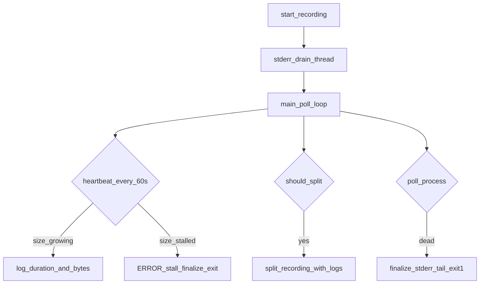

# Harden debut recording logging and split/save reliability

## Problem (from sidecar evidence)

The timing sidecar for `CAM_2026-10-09T142853` shows ~17 min recorded, unclean FFmpeg exit (`ffmpeg_returncode: 4294967295` / -1), and `ffprobe_duration: null`. Auto-split never ran because wall time never reached 3600s. Root risks in code:

- [src/dshow_recorder.py](src/dshow_recorder.py) uses `stderr=subprocess.PIPE` with no reader during capture (pipe-fill deadlock; stop via `q` often falls through to terminate/kill).
- Unexpected FFmpeg death in [examples/debut_example.py](examples/debut_example.py) only prints and `break`s — no finalize, no non-zero exit, no stderr tail.
- No `logging.basicConfig` in debut example, so recorder `logger.*` is invisible.
- No live “still writing” signal, so a frozen FFmpeg looks like a healthy loop.

## Approach

### 1. Fix FFmpeg I/O in [src/dshow_recorder.py](src/dshow_recorder.py)

- Start a daemon thread that continuously reads `proc.stderr` into a bounded deque (last ~200 lines).
- On stop: join the drain thread briefly; use the buffered tail instead of a blocking `stderr.read()` after `wait`.
- Add FFmpeg flags `-nostats` and `-loglevel warning` in `build_ffmpeg_command` so progress spam cannot fill the pipe.
- Keep graceful `q` then timed wait then terminate then kill; log which path was used at WARNING when unclean.
- Add helpers for the example loop:
  - `get_output_size_bytes() -> Optional[int]`
  - `get_stderr_tail(n=40) -> str`
  - `finalize_after_unexpected_exit(returncode) -> Optional[Path]` — finalize sidecar/file when the process already died (`poll_process` currently nulls `_process` and leaves the segment unfinished).

### 2. Make the debut loop noisy and non-silent in [examples/debut_example.py](examples/debut_example.py)

- `logging.basicConfig(level=INFO, ...)` at startup (same pattern as [examples/epocXEyeCamUSB_example.py](examples/epocXEyeCamUSB_example.py)).
- Log resolved devices, full output path, `auto_split_duration`, and FFmpeg command at start.
- Heartbeat every 60s: segment index, elapsed seconds, output file size, next split ETA. If size unchanged for **90s** after the file has grown at least once, treat as hard failure: finalize if possible, print stderr tail, exit code 1.
- On auto-split: log old/new paths and durations; on failure, finalize current if needed, print stderr, exit 1 (not a quiet `break`).
- On unexpected FFmpeg exit: call `finalize_after_unexpected_exit`, print return code + stderr tail, exit 1.
- On Ctrl+C: keep graceful stop; log final path, duration, and FFmpeg returncode from sidecar.

### 3. Tests in [tests/test_dshow_recorder.py](tests/test_dshow_recorder.py)

- Assert `build_ffmpeg_command` includes `-nostats` and `-loglevel`.
- Mock Popen with a stderr that emits many lines; start/stop (or split) without hang; stderr tail available.
- `finalize_after_unexpected_exit` writes stop fields into the sidecar when process is already gone.
- Keep existing split segment-index test green (adjust mocks for drain thread / new flags).

## Out of scope

- Changing `auto_split_duration` or output paths in YAML.
- Manual Ctrl+S split hotkey for debut.
- Web UI / frame_pipe `VideoRecorder` path.
