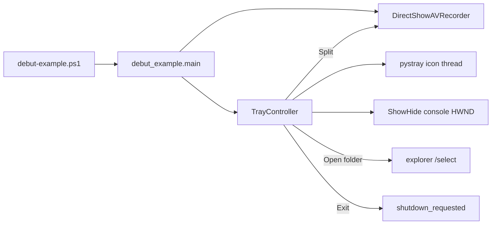

# System tray for continuous video recorder

## Goal

When launching via [`scripts/debut-example.ps1`](c:\Users\pho\repos\EmotivEpoc\ACTIVE_DEV\continuous_video_recorder\scripts\debut-example.ps1) (`uv run debut-example`), recording continues with a tray icon; the console can be hidden/shown without stopping FFmpeg. Same tray module will also be wired into [`examples/epocXEyeCamUSB_example.py`](c:\Users\pho\repos\EmotivEpoc\ACTIVE_DEV\continuous_video_recorder\examples\epocXEyeCamUSB_example.py) so the two configs can show distinct indicators.

This is a focused first slice of the larger tray/Qt vision in [`TODO.md`](c:\Users\pho\repos\EmotivEpoc\ACTIVE_DEV\continuous_video_recorder\TODO.md) (no hover preview / full Qt manager window yet).

## Approach (locked)

**Library:** `pystray` + existing `Pillow` for icon drawing. Keeps the recording poll loop on the main thread (Debut’s current design) and runs the tray on a daemon thread. Avoids forcing a Qt event loop onto `debut_example`’s main thread.

**Console show/hide:** Win32 `GetConsoleWindow` + `ShowWindow(SW_HIDE/SW_SHOW)`. Left-click tray icon toggles visibility.

**Close → tray:** Subclass the console HWND so `WM_CLOSE` hides the window (`SW_HIDE`) instead of exiting. If subclassing fails on this ConHost build, remove `SC_CLOSE` from the system menu and treat tray left-click / “Show Console” as the hide/show path (exit only via menu “Exit Application” or Ctrl+C while console is focused).

**Exit:** Tray “Exit Application” sets the same `_shutdown_requested` path as SIGINT (finalize segment, LSL close, stop tray, exit). Closing the console must **not** exit.

## Config

Add a top-level `tray` block to [`src/config_loader.py`](c:\Users\pho\repos\EmotivEpoc\ACTIVE_DEV\continuous_video_recorder\src\config_loader.py) defaults + light validation:

- `enabled: true`
- `indicator_shape: hexagon | circle` (reject `square`)
- `indicator_color: "#RRGGBB"`
- `flash_interval_ms: 500`

Profile values:

- [`config_webcam_debut.yaml`](c:\Users\pho\repos\EmotivEpoc\ACTIVE_DEV\continuous_video_recorder\config_webcam_debut.yaml): orange hexagon (`#FF8C00`, `hexagon`)
- [`config_epocX_eyecamUSB.yaml`](c:\Users\pho\repos\EmotivEpoc\ACTIVE_DEV\continuous_video_recorder\config_epocX_eyecamUSB.yaml): pink circle (`#FF69B4`, `circle`)

## New module: `src/tray_controller.py`

Responsibilities:

1. **Icon compositing** — draw a black camera glyph; overlay the configured shape/color badge; animate flash while `is_recording()` by alternating badge on/off on a timer and calling `icon.icon = ...`.
2. **Menu** — `Show Console` (or `Hide Console` based on state), `Split Recording`, `Open Recording Folder`, `Exit Application`.
3. **Callbacks** — thread-safe action queue / flags consumed by the main loop (same pattern as `manual_split_seq` in `main.py`), so tray clicks never call FFmpeg stop/start directly from the pystray thread.
4. **Console HWND helpers** — show/hide, WM_CLOSE → hide, optional SC_CLOSE fallback.
5. **Lifecycle** — `start()`, `stop()`, `update_recording_state(bool)`.

Tooltip text: short label from config camera name + recording status.

## Wire into Debut

In [`examples/debut_example.py`](c:\Users\pho\repos\EmotivEpoc\ACTIVE_DEV\continuous_video_recorder\examples\debut_example.py):

- After successful `start_recording()`, start `TrayController` when `tray.enabled`.
- In the main poll loop, drain tray actions:
  - `split` → existing `_split_or_fail("manual_split")`
  - `open_folder` → existing `_reveal_in_file_manager(...)`
  - `exit` → set `_shutdown_requested` and run the same finalize path as SIGINT
  - `toggle_console` handled inside tray (or via flag)
- On shutdown / `_fail_recording`, stop the tray icon.
- Keep existing `s` / `o` console keys when the console is visible.

No change required to [`scripts/debut-example.ps1`](c:\Users\pho\repos\EmotivEpoc\ACTIVE_DEV\continuous_video_recorder\scripts\debut-example.ps1) beyond optional comment; `uv run debut-example` already attaches a console the tray can hide.

## Wire into epocX

In [`examples/epocXEyeCamUSB_example.py`](c:\Users\pho\repos\EmotivEpoc\ACTIVE_DEV\continuous_video_recorder\examples\epocXEyeCamUSB_example.py) / [`src/usb_continuous_recorder.py`](c:\Users\pho\repos\EmotivEpoc\ACTIVE_DEV\continuous_video_recorder\src\usb_continuous_recorder.py):

- Start the same tray controller with that config’s pink circle.
- **Split Recording** → call existing auto-split / `split_recording` path (USB stack already has `_handle_auto_split`).
- **Open Recording Folder** → reuse or share `_reveal_in_file_manager` (extract to `src/utils.py` if not already shareable).
- **Exit** → existing `recorder.shutdown()`.

## Dependencies

Add `pystray` to [`pyproject.toml`](c:\Users\pho\repos\EmotivEpoc\ACTIVE_DEV\continuous_video_recorder\pyproject.toml) and refresh the lockfile with `uv lock` / `uv sync`.

## Out of scope (this pass)

- Hover thumbnail preview, full Qt camera manager, per-camera multi-tray icons (`TODO.md` later work).
- Changing `main.py` presence-based path (unless needed for shared helpers).
- Replacing FFmpeg/recording backends.